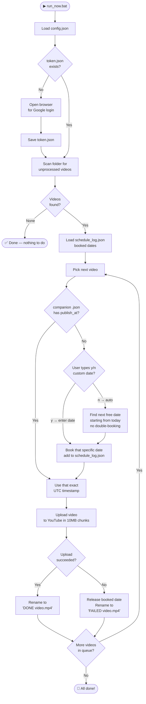

# 🎬 Auto-Uploader (YouTube & Instagram)

> **Drop videos → Run one file → Automatically uploads & schedules to YouTube and Instagram Reels.**

No coding knowledge needed. Everything lives in a single folder. Works on Windows.

---

## 📋 Table of Contents

- [Features](#-features)
- [Folder Structure](#-folder-structure)
- [One-Time Setup](#-one-time-setup-5-minutes)
- [Daily Use](#-daily-use)
- [Custom Metadata](#-custom-metadata-title-tags-thumbnail)
- [Scheduling Logic](#-scheduling-logic)
- [How It Works — Flow Diagram](#-how-it-works--flow-diagram)
- [Config Reference](#-config-reference)
- [Benefits](#-benefits)
- [FAQ](#-faq)

---

## ✨ Features

| Feature | Details |
|---|---|
| 🌐 **Multi-Platform** | Upload simultaneously to **YouTube** and **Instagram Reels** |
| ✅ **One-click upload** | Double-click `run_now.bat` — done |
| 📅 **Auto scheduling** | Each video gets its own unique day on YouTube, no clashes |
| 🗓️ **Custom date picker** | Per-video prompt: auto-assign or enter your own date |
| 🔁 **Background watcher** | `start_watcher.bat` monitors the folder 24/7 |
| 🏷️ **Rich metadata** | Sets title, hashtags, description, and cover thumbnail automatically |
| 🛡️ **Never double-uploads** | Processed videos are renamed `[DONE]` automatically |
| 💾 **Persistent schedule log** | `schedule_log.json` remembers booked dates across runs |
| 🔐 **Secure auth** | YouTube OAuth 2.0 & Instagram encrypted session caching (`ig_session.json`) |

---

## 📁 Folder Structure

```
yt-auto-uploader/
│
├── 📄 run_now.bat             ← Double-click to process all videos right now
├── 📄 start_watcher.bat       ← Keeps running in background, checks every 30s
│
├── 🐍 uploader.py             ← Core upload engine
├── 🐍 watcher.py              ← Background folder watcher
│
├── ⚙️  config.json             ← Your settings (publish time, tags, etc.)
├── 🔐 client_secret.json      ← Your Google OAuth file (you add this once)
├── 🔑 token.json              ← Auto-generated after first login (do not delete)
├── 📅 schedule_log.json       ← Auto-generated, tracks booked dates
│
├── 🎬 YourVideo.mp4           ← Drop videos here!
├── 📝 YourVideo.txt           ← (Optional) Custom title, tags, description
├── 🖼️  YourVideo.jpg           ← (Optional) Custom thumbnail
│
├── ✅ [DONE] YourVideo.mp4    ← Renamed after successful upload
└── ❌ [FAILED] YourVideo.mp4  ← Renamed if upload fails (safe to retry)
```

---

## 🚀 One-Time Setup (5 Minutes)

### Step 1 — Install Python dependencies

Open a terminal in this folder and run:

```bash
pip install -r requirements.txt
```

### Step 2 — Create your Google Cloud credentials

1. Go to [Google Cloud Console](https://console.cloud.google.com/) and sign in.
2. Click **Create Project** → name it `YouTube Uploader` → click **Create**.
3. In the top search bar search for **YouTube Data API v3** → click it → click **Enable**.
4. Go to **APIs & Services** → **OAuth consent screen**:
   - Choose **External** → click **Create**.
   - Fill in App name (`YouTube Uploader`) and your email.
   - Under **Test users** → click **+ Add Users** → enter your YouTube Google account email.
   - Save and continue through all steps.
5. Go to **APIs & Services** → **Credentials**:
   - Click **+ Create Credentials** → **OAuth client ID**.
   - Application type: **Desktop app** → click **Create**.
6. Click **Download JSON** on the credential you just created.
7. Rename the downloaded file to **`client_secret.json`**.
8. Place it directly in this folder.

### Step 3 — First run (one-time browser login)

Double-click **`run_now.bat`**.

A browser window will open asking you to sign in with your YouTube Google account. Click **Allow**. This only happens once — the token is saved to `token.json` automatically.

---

## 🎬 Daily Use

### Option A — Manual (run on demand)

1. Drop your video (e.g. `My_Vlog.mp4`) into this folder.
2. Double-click **`run_now.bat`**.
3. For each video, you'll be asked:
   ```
   Video: My_Vlog.mp4
   Set a custom date for this video? (y/n):
   ```
   - Type **`n`** → auto-assigns the next free date.
   - Type **`y`** → enter your own date in `DD/MM/YYYY` format.
4. The video uploads. When done it's renamed to `[DONE] My_Vlog.mp4`.

### Option B — Background watcher (always on)

Double-click **`start_watcher.bat`** once and leave it running.  
Whenever you drop a new video into the folder, it uploads automatically within 30 seconds.

> **Note:** The watcher doesn't show the custom-date prompt — it uses auto-scheduling. Use `run_now.bat` when you want to pick custom dates.

---

## 🏷️ Custom Metadata (Title, Tags, Thumbnail)

By default the filename is used as the video title. To customise:

### Using a `.txt` file

Create a file with the **same name** as your video but `.txt` extension:

```
My_Vlog.txt
```

```
My Custom Video Title          ← Line 1: Title
travel, vlog, india, 2026      ← Line 2: Tags (comma separated)
This is my full description.   ← Line 3+: Description (can be many lines)
Everything below line 2 is
treated as the description.
```

### Using a `.json` file (advanced)

```json
{
  "title": "My Custom Title",
  "description": "Full description here.",
  "tags": ["travel", "vlog", "india"],
  "category_id": "22",
  "publish_at": "2026-12-01T12:30:00.000Z"
}
```

> Setting `publish_at` in the JSON skips the date prompt entirely and uses that exact UTC time.

### Thumbnail

Drop an image with the **same name** as your video:

```
My_Vlog.jpg   or   My_Vlog.png
```

The uploader sets it as the YouTube thumbnail automatically.

> **Note:** Custom thumbnails require a [verified YouTube channel](https://www.youtube.com/verify).

---

## 📅 Scheduling Logic

The uploader enforces a strict **one video per calendar day** rule.

```
Today: 11 Nov 2026
4 videos in folder → run_now.bat
```

| Video | Auto-scheduled for |
|---|---|
| video1.mp4 | 11/11/2026 at 6:00 PM |
| video2.mp4 | 12/11/2026 at 6:00 PM |
| video3.mp4 | 13/11/2026 at 6:00 PM |
| video4.mp4 | 14/11/2026 at 6:00 PM |

**Run again tomorrow with 2 more videos?**

| Video | Auto-scheduled for |
|---|---|
| video5.mp4 | 15/11/2026 at 6:00 PM ← picks up where it left off |
| video6.mp4 | 16/11/2026 at 6:00 PM |

The `schedule_log.json` file remembers all booked dates. If a video fails to upload, its date is automatically released so it can be reused on the next run.

---

## 🔄 How It Works — Flow Diagram



---

## ⚙️ Config Reference

Edit `config.json` to customise behaviour:

```json
{
  "enable_youtube": true,
  "enable_instagram": true,
  "publish_time": "18:00",
  "schedule_publish": true,
  "auto_stagger_days": true,
  "videos_folder": "videos",
  "default_tags": ["video"],
  "default_category_id": "22",
  "made_for_kids": false,
  "client_secrets_file": "client_secret.json",
  "token_file": "token.json",
  "instagram": {
    "username": "",
    "password": "",
    "session_file": "ig_session.json",
    "as_reel": true
  }
}
```

| Key | Default | Description |
|---|---|---|
| `enable_youtube` | `true` | Set `true` to upload to YouTube |
| `enable_instagram` | `true` | Set `true` to upload to Instagram |
| `instagram.username` | `""` | Instagram username (or set via `IG_USERNAME` env variable; prompts if empty) |
| `instagram.password` | `""` | Instagram password (or set via `IG_PASSWORD` env variable; prompts if empty) |
| `instagram.session_file` | `"ig_session.json"` | Stores login cookies so you don't re-login every run |
| `instagram.as_reel` | `true` | Upload as Instagram Reel (`true`) or regular feed video (`false`) |
| `publish_time` | `"18:00"` | YouTube scheduled publish time (24-hour, local time) |
| `schedule_publish` | `true` | YouTube scheduling (`false` = upload private unscheduled) |
| `auto_stagger_days` | `true` | YouTube one-video-per-day auto-stagger |
| `default_tags` | `["video"]` | Fallback tags / hashtags when no `.txt`/`.json` file exists |
| `default_category_id` | `"22"` | YouTube category — `22` = People & Blogs |
| `made_for_kids` | `false` | YouTube COPPA setting |

**Common YouTube category IDs:**

| ID | Category |
|---|---|
| `1` | Film & Animation |
| `10` | Music |
| `20` | Gaming |
| `22` | People & Blogs |
| `23` | Comedy |
| `24` | Entertainment |
| `25` | News & Politics |
| `26` | Howto & Style |
| `27` | Education |
| `28` | Science & Technology |

---

## 💡 Benefits

- **Consistent posting schedule** — YouTube's algorithm rewards channels that post regularly. This tool automates that consistency effortlessly.
- **Zero double-uploads** — The `[DONE]` prefix and `schedule_log.json` together guarantee each video is uploaded exactly once.
- **No clashing dates** — Even across multiple runs on different days, the schedule log ensures every video gets its own unique calendar slot.
- **Full control when needed** — Override any video's date with a simple `y/n` prompt, without breaking the auto-schedule for other videos.
- **Fail-safe** — If an upload fails, the date is freed up and the file is marked `[FAILED]` so you can easily retry.
- **No internet dependency at rest** — When using the background watcher, it only reaches out to YouTube when it actually finds a new video.

---

## ❓ FAQ

**Q: Can I change the publish time after uploading?**  
A: Yes, go to YouTube Studio → Content → find the video → edit its schedule directly there.

**Q: What if two runs try to book the same date?**  
A: The `schedule_log.json` is updated immediately when a date is reserved, before the upload even starts. So re-running is always safe.

**Q: Can I delete `schedule_log.json`?**  
A: Yes, but all previously booked dates will be forgotten. The next run will start scheduling from today again, potentially overlapping with already-scheduled YouTube videos.

**Q: What if my `token.json` expires?**  
A: The uploader refreshes it automatically. If it can't, it opens the browser for a fresh login.

**Q: The video uploaded but has the wrong title. How do I fix it?**  
A: Create a `.txt` or `.json` file with the same name as the video *before* running. See [Custom Metadata](#-custom-metadata-title-tags-thumbnail).

**Q: How do I stop the background watcher?**  
A: Click the terminal window that `start_watcher.bat` opened and press `Ctrl + C`.

---

## 🔐 Security Notes

> [!CAUTION]
> Never share or commit `token.json` or `client_secret.json` to a public repository. These files give full access to upload and manage your YouTube channel. The `.gitignore` file in this project already excludes them.

---

*Built for creators who want their content on a consistent schedule — without the manual grind.*
